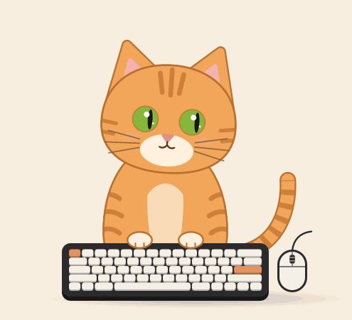
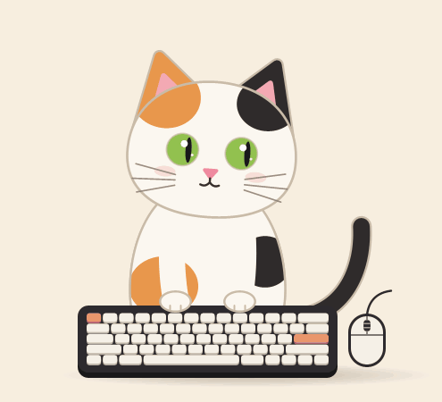
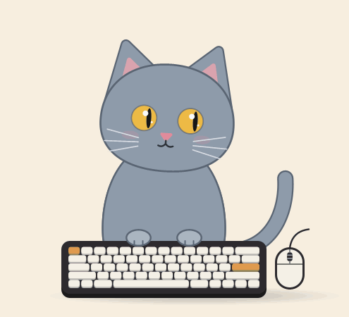
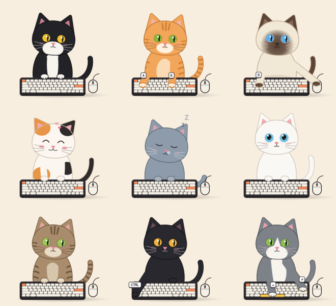

# Gatinho

Um gato que mora no canto da tela e fica do seu lado enquanto você trabalha.

<p align="center">
  
</p>

Ele digita junto com você, pata por pata. Quando você pega o mouse, ele pega o mouse dele também. Se você some por um tempo, ele começa a olhar pro nada, cochila e acaba dormindo em cima do teclado. Quando você volta, ele acorda meio atordoado e sacode a cabeça.

Fiz porque vi o gatinho do [LittleOne](https://xiaozhilittleone.com/) e quis um desses pra mim, rodando no meu computador e não numa aba do navegador.

<p align="center">
  
  
</p>

Dá pra fazer carinho: clica e segura na cabeça dele. Ele fecha os olhos, baixa as orelhas, solta uns coraçõezinhos e começa a ronronar. O som dá pra desligar no menu.

## Os gatos

São nove pelagens. Troca pelo clique direito em cima dele.

<p align="center">
  
</p>

## Instalar

### Mac

```bash
./certificado-local.sh
./build.sh --install
```

O primeiro comando só precisa rodar uma vez por máquina. Ele cria um certificado local pra assinar o app, e é isso que faz o macOS lembrar da permissão depois de cada recompilação. O segundo compila, copia pra `/Applications` e abre.

Na primeira vez o macOS pede acesso de **Acessibilidade**, que é como o gato enxerga o teclado. Não precisa de Xcode, só das Command Line Tools.

### Linux

```bash
sudo apt install libx11-dev libxext-dev libxi-dev
swift build -c release --static-swift-stdlib
.build/release/Gatinho
```

No Wayland (GNOME, KDE) o gato roda pelo XWayland e lê o teclado direto de `/dev/input`. Pra isso seu usuário precisa estar no grupo `input`:

```bash
sudo usermod -aG input $USER
```

Sai e entra de novo na sessão depois. Sem o grupo ele só percebe o que você digita em janelas X11.

### Windows

Com o Swift instalado (`winget install Swift.Toolchain`):

```powershell
swift build -c release
.build\release\Gatinho.exe
```

Ele aparece na bandeja, perto do relógio.

## Convivendo com ele

- Arrasta pelo corpo pra mudar ele de lugar.
- Clique direito abre o menu: pelagem, tamanho, transparência, mostrar ou esconder as letrinhas, ronronar com ou sem som, travar no lugar. No Mac o mesmo menu fica no ícone da barra de menus, e no Windows no ícone da bandeja.
- No Linux o menu aparece dentro da própria janela. Clique esquerdo avança a opção, direito volta, `Esc` fecha.
- `⌃⌥L` no Mac ou `Ctrl+Alt+L` no resto trava o gato. Travado, os cliques passam através dele, então ele não atrapalha nada.

Depois de 15 segundos sem você mexer em nada ele começa a sonhar acordado, e com 40 segundos dorme.

## Sobre o teclado

O gato precisa ver suas teclas pra digitar junto, então vale dizer o que ele faz com elas: guarda na memória só enquanto a tecla está apertada, pra saber qual pata usar e qual letrinha mostrar. Nada vai pra disco, nada sai da máquina. Em campo de senha o próprio sistema esconde as teclas dele.

## Por dentro

É tudo Swift, nos três sistemas. O gato em si (as molas que fazem as patas e a cabeça se mexerem, o desenho, as pelagens, o menu) fica em `Sources/GatinhoCore` e só usa Foundation. Cada sistema tem uma camada fina por cima:

| | janela | teclado e mouse |
|---|---|---|
| Mac | SwiftUI num `NSPanel` | `NSEvent` |
| Linux | X11, transparente ou recortada com XShape | XInput2, ou `/dev/input` no Wayland |
| Windows | `UpdateLayeredWindow` | ganchos `WH_KEYBOARD_LL` e `WH_MOUSE_LL` |

No Linux e no Windows o desenho é feito por um rasterizador próprio, sem biblioteca gráfica nenhuma. Um quadro leva uns 2 ms. O ronronar é um gato de verdade: 8 s de uma gravação do Pixabay ("Real cat purring sound", de feedthestraycats, licença de conteúdo do Pixabay), em laço sem costura e embutidos no executável, que continua sendo um arquivo só. No Mac toca pelo AVFoundation, no Windows pelo `PlaySound` e no Linux pelo `pw-play`, `paplay` ou `aplay`, o que tiver.

Alguns comandos ajudam a conferir as coisas sem abrir janela:

```bash
Gatinho --snapshot estados.png     # a grade de pelagens aí de cima
Gatinho --record digitando x.rgba  # quadros crus de uma cena (digitando, carinho, soneca)
Gatinho --purr ronronar.wav        # grava o laço do ronronar (8 s)
Gatinho --check-smooth             # falha se o rabo ou a respiração derem pulo
Gatinho --benchmark                # quanto tempo leva um quadro
```

Os GIFs deste README saem do `--record` passando pelo ffmpeg:

```bash
ffmpeg -f rawvideo -pix_fmt rgba -s 495x450 -r 30 -i x.rgba \
  -vf "fps=25,split[a][b];[a]palettegen=max_colors=128:stats_mode=diff[p];[b][p]paletteuse=dither=none" docs/digitando.gif
```

O CI (`.github/workflows/build.yml`) compila e testa nos três sistemas. No Linux ele ainda abre o gato numa tela virtual, digita, abre o menu e arrasta ele de lugar (`ci/linux-smoke.sh`).
